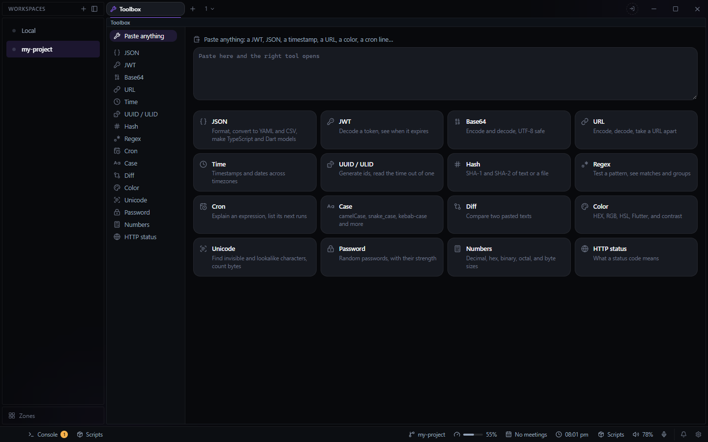

# Toolbox for Deck

The small conversions a developer otherwise opens a website for, in a Deck tab or a pane. Open it
from the **+** beside your tabs and choose **Toolbox**.

The palette has **Toolbox: JSON**, **Toolbox: Cron** and so on for each tool, and **Toolbox: open
what is on the clipboard**. Select text in any editor and right-click **Open in Toolbox**, or use
**Toolbox: open the selection**. For text in a terminal, copy it and use the clipboard command.
These open the Toolbox in a floating window, or in a tab if you choose that in Settings > Layout >
Where things open.

## Paste anything

The Toolbox opens on a paste box. Paste a value and the tool that fits opens with it filled in:

| You paste | It opens |
|---|---|
| a JWT (with or without `Bearer `) | JWT |
| a 10- or 13-digit number, or a date | Time |
| JSON | JSON |
| a UUID or ULID | UUID / ULID, showing its version and when it was made |
| `#1e90ff`, `rgb(...)`, `hsl(...)`, `Color(0xFF1E90FF)` | Color |
| a URL, or text with `%20`-style escapes | URL |
| a cron line or `@daily` | Cron |
| base64 that decodes to text | Base64 |
| text with an invisible character (a zero-width space, a byte order mark) | Unicode |
| `404`, or any status code | HTTP status |
| `0xFF`, `0b1010`, `1.5 GB`, `512MiB` | Numbers |

## Tools

- **JSON**: format (2 spaces, 4, or tabs), minify, and convert JSON to and from YAML and CSV. A
  parse error points at its line and column. YAML input is block YAML only: no anchors, tags or
  multi-line (`|`, `>`) strings. CSV values stay strings, so `007` is not turned into `7`.
  **JSON → TypeScript** and **JSON → Dart** turn one sample into interfaces or model classes
  (Dart with `fromJson` and `toJson`): objects in an array are merged, a key missing from some
  becomes optional, snake_case keys become camelCase fields that still read their own key, and a
  value that is always null comes out as `unknown` / `dynamic`.
- **JWT**: the header and payload, the time claims (`iat`, `nbf`, `exp`) as dates, and whether it
  has expired. The signature is shown but not verified, since that needs the key.
- **Base64**: encode and decode as UTF-8, either alphabet, with a URL-safe option.
- **URL**: encode or decode a component (`+` as a space, optionally), or take a whole URL apart
  into its parts and query parameters.
- **Time**: a Unix timestamp in seconds, milliseconds, microseconds or nanoseconds (told apart by
  size), or a date. A date with no zone is read in the zone you pick, so "14:30 in Tokyo" works.
  Shows the time here, in UTC and in any zones you add.
- **UUID / ULID**: generate UUID v4, UUID v7 (sorts by time) or ULID, up to 1000 at once; paste
  one to see its version and creation time (ULID, UUID v7 and v1 carry one).
- **Hash**: SHA-1, SHA-256, SHA-384 and SHA-512 of text or of a file. No MD5: the browser's
  crypto does not offer it.
- **Regex**: JavaScript regular expressions, with every match highlighted, its groups listed, and
  a replace preview. It runs on Deck's UI thread, so a pattern that backtracks badly on a large
  text pauses the window until it finishes.
- **Cron**: the standard five fields (names like `MON` and `JAN`, ranges, steps, `@daily` and the
  other macros), explained in words, with the next ten runs in this machine's time. When both day
  fields are set, a day matches if either does, which is cron's own rule.
- **Case**: camelCase, PascalCase, snake_case, CONSTANT_CASE, kebab-case, dot.case, Title Case
  and Sentence case, one line at a time.
- **Diff**: two texts side by side (or inline) in Deck's diff editor; both sides are editable.
- **Color**: HEX, RGB, HSL and Flutter's `Color(0x...)`, a picker, and the WCAG contrast ratio
  against white, black and any color you type, with AA and AAA marked.
- **Unicode**: every character with its code point, UTF-8 bytes and category; invisible
  characters, typographic quotes and dashes, and Cyrillic or Greek letters that look Latin are
  flagged and shown where they sit, with a cleaned copy. Counts characters, what is displayed,
  UTF-16 units, UTF-8 bytes, lines and words.
- **Password**: random passwords from the system crypto source, 4 to 128 characters, with every
  kind of character you pick present at least once, an option to leave out lookalikes (I l 1 O 0
  o), and the entropy in bits.
- **Numbers**: an integer in decimal, hex, binary and octal (any size), with the two's complement
  of a negative one; and a size (`1.5 GB`, `512MiB`, `4k`) in every decimal and binary unit.
- **HTTP status**: what a code means, or search by words ("rate limit", "gateway").

What you type stays while Deck runs, shared by the tab and every Toolbox pane, and is never
written to disk: people paste tokens and secrets into a toolbox. The only thing saved is where
it opens, in `data\toolbox\settings.json` in Deck's config folder.
